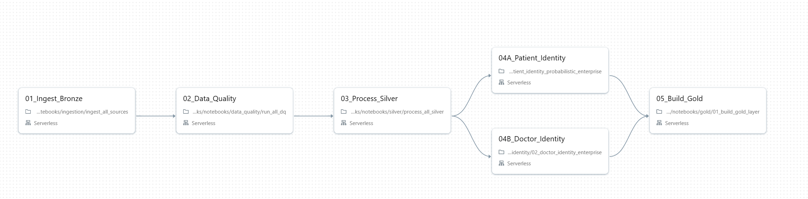
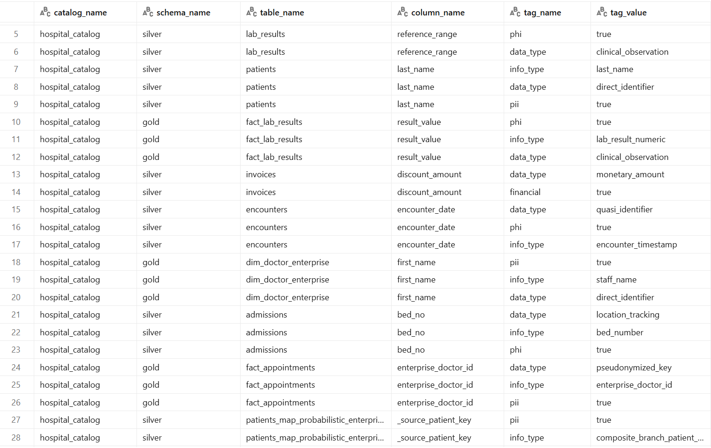
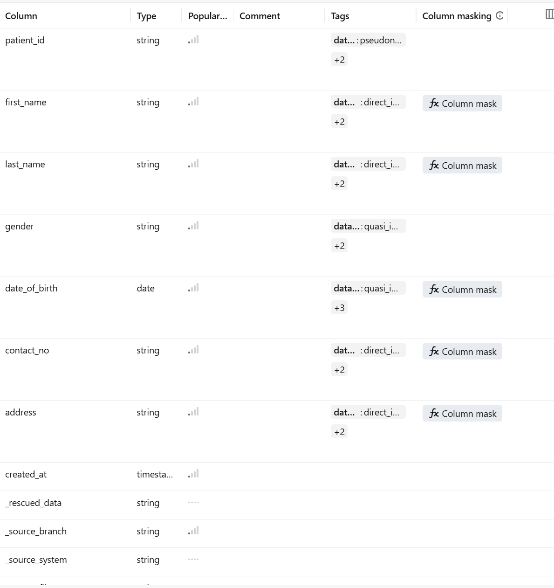
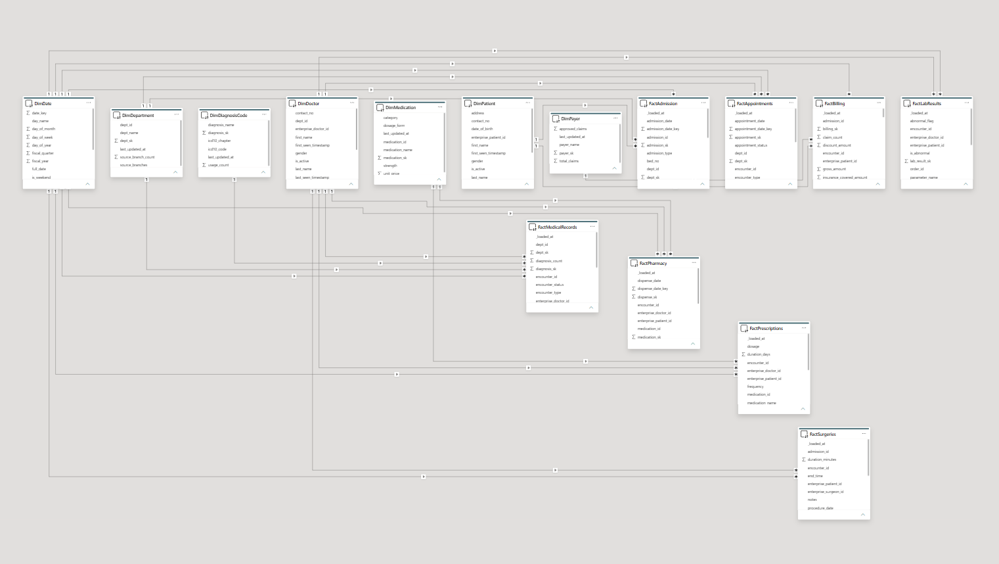
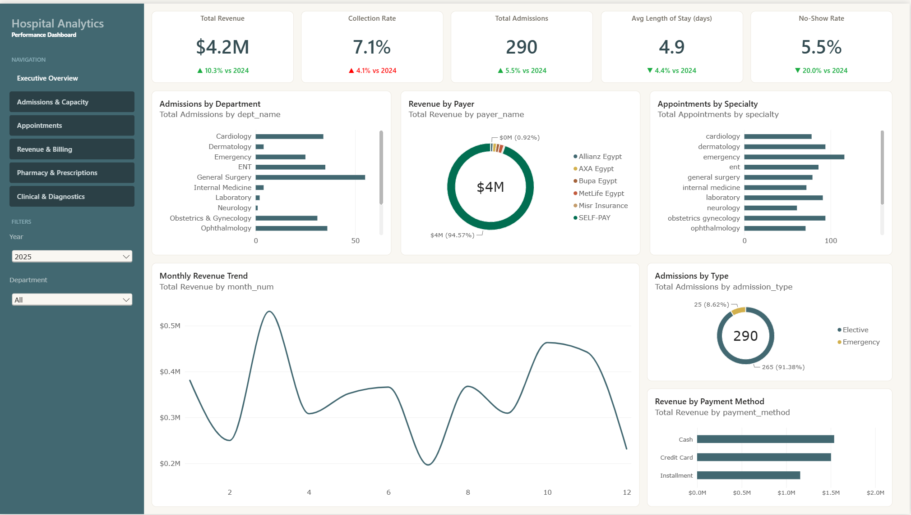
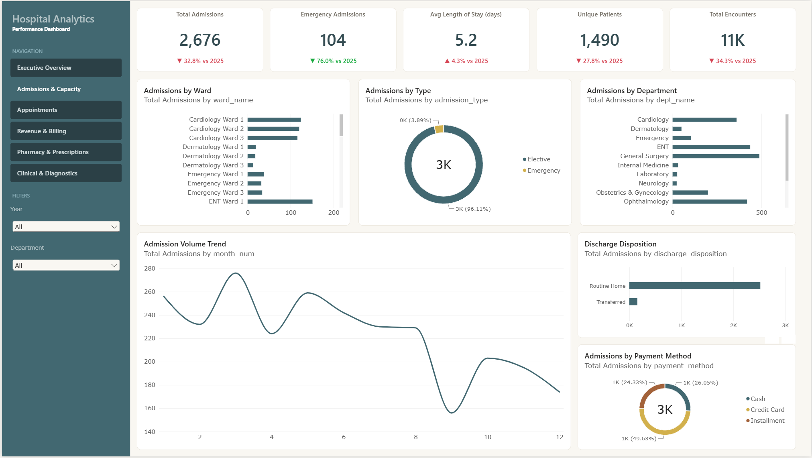
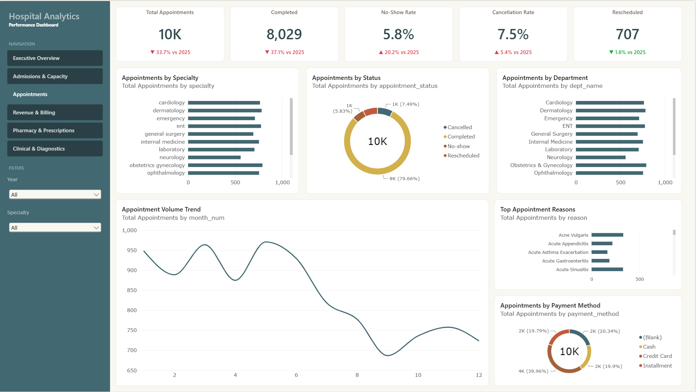
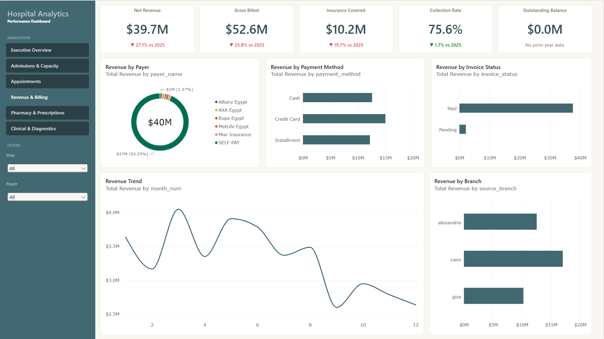
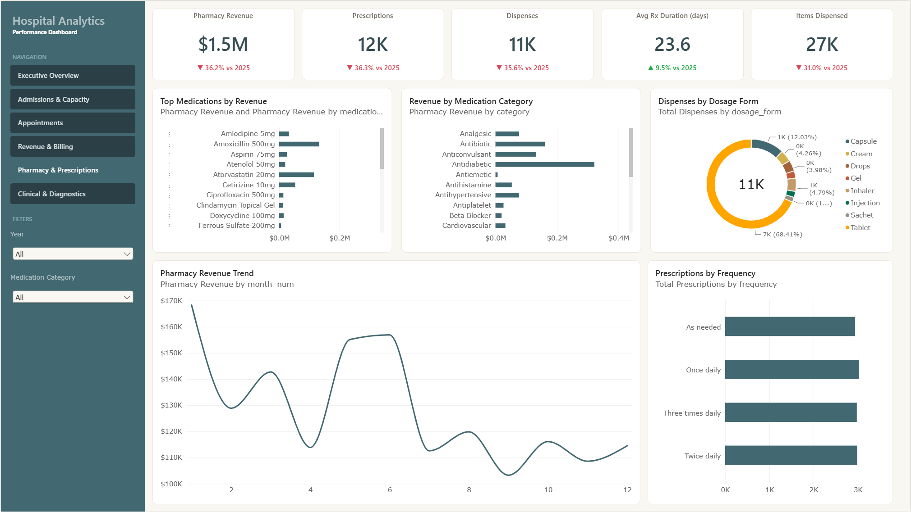
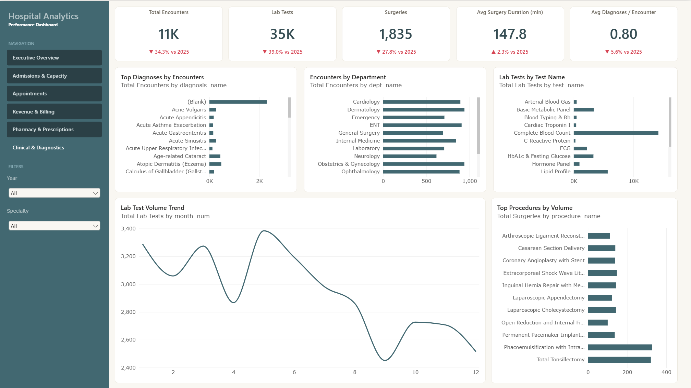

# 🏥 Hospital Enterprise Data Warehouse (EDW)
### *A Production-Grade, End-to-End Healthcare Analytics Platform on Databricks*

---

> **Built on the Databricks Lakehouse Platform** — this project implements a full Medallion Architecture (Bronze → Silver → Gold) for a multi-branch hospital network, complete with probabilistic enterprise identity resolution, automated data quality validation, Unity Catalog governance with tag-based PII masking, and a multi-page Power BI analytical dashboard.

---

## 📋 Table of Contents

1. [Project Overview](#1-project-overview)
2. [Architecture](#2-architecture)
3. [Data Source & Generation](#3-data-source--generation)
4. [Medallion Layers](#4-medallion-layers)
   - [Bronze — Raw Ingestion](#41-bronze--raw-ingestion)
   - [Silver — Cleaning & Curation](#42-silver--cleaning--curation)
   - [Identity Resolution](#43-identity-resolution--master-data-management)
   - [Gold — Star Schema](#44-gold--star-schema)
5. [Data Quality Framework](#5-data-quality-framework)
6. [Data Governance](#6-data-governance--unity-catalog)
7. [Pipeline Automation](#7-pipeline-automation--databricks-workflows)
8. [Dimensional Model](#8-dimensional-model)
9. [Analytics Dashboard](#9-analytics-dashboard)
10. [Repository Structure](#10-repository-structure)
11. [Getting Started](#11-getting-started)

---

## 1. Project Overview

The **Hospital EDW** is a complete data engineering reference project simulating the real-world challenges of a healthcare enterprise:

| Aspect | Detail |
|---|---|
| **Domain** | Multi-branch hospital network (Cairo · Giza · Alexandria) |
| **Platform** | Databricks Lakehouse (Unity Catalog) |
| **Architecture** | Medallion — Bronze → Silver → Gold |
| **Source Systems** | EMR, Laboratory, Pharmacy, Billing |
| **Tables Ingested** | 15 source tables × 3 branches = 45 raw files |
| **Gold Tables** | 5 conformed dimensions + 2 enterprise identity dims + 8 fact tables |
| **Identity Resolution** | Fellegi-Sunter probabilistic matching with graph-based clustering |
| **Governance** | PII tags, column-level masking policies, RBAC via Unity Catalog |
| **Orchestration** | Databricks Workflows (DAG) + Databricks Asset Bundles (DABs) |
| **Analytics** | 6-page Power BI dashboard |

---

## 2. Architecture

The pipeline follows the **Medallion Architecture**, with an enterprise-grade **Probabilistic Identity Resolution** stage sitting between Silver and Gold.

```
┌─────────────────────────────────────────────────────────────────────┐
│                    RAW CSV FILES IN VOLUMES                         │
│   /Volumes/hospital_catalog/raw_landing/raw_files/{branch}/...      │
└─────────────────────────────────┬───────────────────────────────────┘
                                  │  Auto Loader / Batch Ingest
                                  ▼
┌─────────────────────────────────────────────────────────────────────┐
│                          BRONZE LAYER                               │
│  Append-only ingestion · Schema enforcement · Audit metadata        │
│  hospital_catalog.bronze.*  (15 tables × 3 branches)               │
└───────────────────┬─────────────────────────────────────────────────┘
                    │  High-watermark incremental read
                    ▼
┌─────────────────────────────────────────────────────────────────────┐
│                     DATA QUALITY GATE                               │
│  200+ rules · Completeness · Uniqueness · Validity · RI checks      │
│  CRITICAL failures → Quarantine  |  MEDIUM → Pass-through           │
└───────────────────┬─────────────────────────────────────────────────┘
                    │  Delta MERGE (upsert)
                    ▼
┌─────────────────────────────────────────────────────────────────────┐
│                          SILVER LAYER                               │
│  Cleaned · Standardized · Deduplicated · hospital_catalog.silver.*  │
└──────────────────┬────────────────────────────┬─────────────────────┘
                   │                            │
                   ▼                            ▼
      ┌────────────────────┐        ┌──────────────────────┐
      │  PATIENT IDENTITY  │        │  DOCTOR IDENTITY     │
      │  Fellegi-Sunter    │        │  Fellegi-Sunter      │
      │  Probabilistic     │        │  Probabilistic       │
      │  Matching +        │        │  Matching            │
      │  Graph Clustering  │        │                      │
      │  EP-<uuid> IDs     │        │  ED-<uuid> IDs       │
      └──────────┬─────────┘        └──────────┬───────────┘
                 └──────────────┬───────────────┘
                                ▼
┌─────────────────────────────────────────────────────────────────────┐
│                           GOLD LAYER                                │
│  Star Schema · Conformed Dimensions + 8 Fact Tables                 │
│  hospital_catalog.gold.*                                            │
└─────────────────────────────────┬───────────────────────────────────┘
                                  │
                                  ▼
┌─────────────────────────────────────────────────────────────────────┐
│              BI & ANALYTICS CONSUMPTION                             │
│  Power BI · Databricks SQL Dashboards · Clinical Analytics          │
└─────────────────────────────────────────────────────────────────────┘
```

### ETL Job DAG (Databricks Workflows)

The pipeline is orchestrated as a 5-task Databricks Workflow. Tasks 04A and 04B run **in parallel** to reduce total runtime:



| Task | Notebook | Depends On |
|---|---|---|
| `01_Ingest_Bronze` | `notebooks/ingestion/ingest_all_sources` | — |
| `02_Data_Quality` | `notebooks/data_quality/run_all_dq` | `01_Ingest_Bronze` |
| `03_Process_Silver` | `notebooks/silver/process_all_silver` | `02_Data_Quality` |
| `04A_Patient_Identity` | `notebooks/identity/01_patient_identity_probabilistic_enterprise` | `03_Process_Silver` |
| `04B_Doctor_Identity` | `notebooks/identity/02_doctor_identity_enterprise` | `03_Process_Silver` |
| `05_Build_Gold` | `notebooks/gold/01_build_gold_layer` | `04A`, `04B` |

---

## 3. Data Source & Generation

Hospital data is generated by a **self-contained Python script** that produces realistic, intentionally messy, overlapping patient records across three independent hospital branches — faithfully simulating the Master Patient Index problem.

### Branches & Source Systems

| Branch | Prefix | Specialty Profile |
|---|---|---|
| **Cairo** | `CAI-` | Largest; all specialties |
| **Giza** | `GIZ-` | Mid-size; missing Neurology & Urology |
| **Alexandria** | `ALX-` | Oversized Emergency department |

### Source Domains

```
EMR        → patients, doctors, departments, encounters,
              diagnoses, procedures, admissions
Laboratory → lab_orders, lab_results
Pharmacy   → medications, prescriptions, pharmacy_transactions
Billing    → invoices, payments, insurance_claims
```

### Cross-Branch Overlap (The Identity Challenge)

The generator deliberately creates **dirty duplicates** to simulate real-world Master Patient Index problems:

- **~30% of patients** appear in more than one branch with their own local `patient_id`
- **~50% of duplicate patient rows** have intentional data quality noise:
  - Different name casing (`Ahmed` vs `AHMED` vs `ahmed`)
  - Different phone formats (`01012345678` vs `+201012345678`)
  - Different date formats (`2026-08-20` vs `20/08/2026`)
  - Different gender encodings (`M` vs `Male` vs `male`)
- **~10% of doctors** hold credentials across multiple branches
- Ground truth identity maps (`enterprise_patient_map.csv`, `enterprise_staff_map.csv`) are provided for validation

### Generating Data

```bash
# Generate ~57K rows across all 3 branches (fast — under 1 second)
cd hospital_edw_data_generation/files
python generate_hospital_data.py --patients 3000 --seed 42 --outdir output

# Scale up for a bigger dataset
python generate_hospital_data.py --patients 20000 --seed 42 --outdir output
```

| Flag | Default | Description |
|---|---|---|
| `--patients` | 3000 | Number of distinct master patients |
| `--seed` | 42 | Reproducibility seed |
| `--outdir` | `output` | Output directory for CSVs |
| `--start-date` | 2019-01-01 | Simulation start date |
| `--end-date` | 2026-08-29 | Simulation end date |

---

## 4. Medallion Layers

### 4.1 Bronze — Raw Ingestion

The Bronze layer is an **append-only** landing zone. Every source file is ingested with full fidelity — no transformations, no filtering.

**Key components:**

| Component | File | Responsibility |
|---|---|---|
| Configuration | [`config/ingestion_config.py`](config/ingestion_config.py) | Catalog paths, branch list, domain → table mapping |
| Schema Contract | [`config/schemas.py`](config/schemas.py) | Explicit PySpark `StructType` for all 15 tables |
| File Reader | [`src/ingestion/reader.py`](src/ingestion/reader.py) | CSV reads with schema enforcement |
| Delta Writer | [`src/ingestion/writer.py`](src/ingestion/writer.py) | Append to Bronze Delta tables |
| Metadata Enricher | [`src/ingestion/metadata.py`](src/ingestion/metadata.py) | Adds audit columns |
| Pipeline Runner | [`src/ingestion/pipeline.py`](src/ingestion/pipeline.py) | Orchestrates single-table ingestion |
| Notebook | [`notebooks/ingestion/ingest_all_sources.ipynb`](notebooks/ingestion/ingest_all_sources.ipynb) | Loops all branches × tables |

**Audit columns added to every Bronze row:**

```python
_source_branch        # 'cairo' | 'giza' | 'alexandria'
_source_system        # 'emr' | 'laboratory' | 'pharmacy' | 'billing'
_ingestion_timestamp  # current_timestamp() at ingest time
_batch_id             # UUID per pipeline run
_source_file          # originating CSV file path
```

---

### 4.2 Silver — Cleaning & Curation

The Silver layer applies **incremental** high-watermark reads from Bronze, transforms/cleans data, deduplicates, and upserts via **Delta MERGE**.

**Key components:**

| Component | File | Responsibility |
|---|---|---|
| Configuration | [`config/silver_config.py`](config/silver_config.py) | Primary keys, partition cols, watermark column per table |
| Domain Transforms | [`src/silver/transforms.py`](src/silver/transforms.py) | Cleaning logic for all 15 tables |
| Standardization | [`src/silver/standardization.py`](src/silver/standardization.py) | Name, phone, gender, date normalization |
| Deduplication | [`src/silver/deduplication.py`](src/silver/deduplication.py) | `ROW_NUMBER() OVER (PARTITION BY pk ORDER BY _ingestion_timestamp DESC)` |
| Delta MERGE Writer | [`src/silver/writer.py`](src/silver/writer.py) | Incremental watermark read + `DeltaTable.merge()` |
| Notebook | [`notebooks/silver/process_all_silver.ipynb`](notebooks/silver/process_all_silver.ipynb) | Runs all 15 Silver merges |

**Transformations applied per domain:**

| Domain | Tables | Key Transformations |
|---|---|---|
| **EMR** | patients, doctors, departments, encounters, diagnoses, procedures, admissions | Name normalization, DOB parsing (multi-format), gender standardization (`M`/`F`/`O`), phone cleaning |
| **Laboratory** | lab_orders, lab_results | Abnormal flag mapping (`A`→Abnormal, `H`→High, `L`→Low, `N`→Normal), date parsing |
| **Pharmacy** | medications, prescriptions, pharmacy_transactions | Dosage cleaning, duration standardization, dispensed status normalization |
| **Billing** | invoices, payments, insurance_claims | Amount casting, status standardization, date parsing |

---

### 4.3 Identity Resolution — Master Data Management

The most sophisticated layer in the pipeline. Implements a **Fellegi-Sunter probabilistic record linkage** model to deduplicate patients and doctors across branches, assigning stable enterprise-wide IDs.

**How It Works:**

```
1. PREPARATION
   Load silver.patients / silver.doctors
   Standardize names, national IDs
   Reject corrupted or blank records

2. BLOCKING
   Candidate pair generation using blocking rules
   (soundex name, birth year, etc.) to reduce O(n^2) comparisons

3. SCORING  (Fellegi-Sunter)
   Compute match probability for each candidate pair:
   - Exact / fuzzy name match
   - National ID match
   - Date of birth match
   - Phone number match
   - Address similarity

4. CLASSIFICATION
   score >= 0.95  ->  AUTO MERGE  (enterprise ID assigned)
   0.70 <= score < 0.95  ->  STEWARD REVIEW QUEUE
   score < 0.70  ->  NON-MATCH (treated as distinct entity)

5. GRAPH CLUSTERING
   Connected components algorithm on matched pairs
   to resolve transitive links (A=B, B=C -> A=B=C)

6. RESOLUTION
   Assign stable EP-<uuid> (Patient) / ED-<uuid> (Doctor) IDs
   Write alias bridge maps and golden dimension records
```

**Thresholds:**

| Entity | Auto-Merge Threshold | Review Threshold | Max Iterations |
|---|---|---|---|
| **Patient** | >= 0.95 | 0.70 – 0.94 | 25 |
| **Doctor** | >= 0.92 | 0.65 – 0.91 | 25 |

> Doctor threshold is slightly lower because there is no DOB field — specialty and license number compensate.

**Outputs:**

| Table | Description |
|---|---|
| `silver.patients_map_probabilistic_enterprise` | Bridge map: `(source_branch, source_patient_id)` → `enterprise_patient_id` |
| `silver.doctors_map_probabilistic_enterprise` | Bridge map: `(source_branch, source_doctor_id)` → `enterprise_doctor_id` |
| `gold.dim_patient_enterprise` | Golden patient record with unified attributes |
| `gold.dim_doctor_enterprise` | Golden doctor record with unified attributes |
| `silver.patient_identity_registry_enterprise` | Full audit of all enterprise entity assignments |
| `silver.patient_steward_review_queue_enterprise` | Pairs in the manual review band |
| `silver.patient_identity_run_audit_enterprise` | Run-level statistics per pipeline execution |

---

### 4.4 Gold — Star Schema

The Gold layer implements a clean **Star Schema** optimized for BI consumption. All fact tables carry enterprise patient/doctor IDs resolved from the identity bridge maps.

**Dimensions:**

| Table | Grain | Surrogate Key | Description |
|---|---|---|---|
| `dim_date` | One row per calendar day (2015–2035) | `date_key` (YYYYMMDD int) | Full calendar attributes incl. fiscal year (Apr–Mar MOHP cycle) |
| `dim_department` | One row per hospital department | `dept_sk` INT | Department name, cross-branch count, source branches |
| `dim_medication` | One row per drug | `medication_sk` INT | Drug name, category, dosage form, strength, unit dose |
| `dim_diagnosis_code` | One row per ICD-10 code | `diagnosis_sk` INT | ICD-10 chapter, code, description |
| `dim_payer` | One row per insurance payer + SELF-PAY | `payer_sk` INT (0 = SELF-PAY) | Payer name, approved claims, total claims |
| `dim_patient_enterprise` | One row per enterprise patient | `enterprise_patient_id` STRING | Golden patient record (managed by identity notebooks) |
| `dim_doctor_enterprise` | One row per enterprise doctor | `enterprise_doctor_id` STRING | Golden doctor record (managed by identity notebooks) |

**Fact Tables:**

| Table | Grain | Key Measures |
|---|---|---|
| `fact_appointments` | One row per outpatient/emergency encounter | `appointment_status`, `encounter_type`, `dept_sk`, `enterprise_patient_id`, `enterprise_doctor_id` |
| `fact_admissions` | One row per inpatient admission | `admission_type`, `discharge_disposition`, `length_of_stay_days`, `bed_no`, `ward_name` |
| `fact_medical_records` | One row per clinical encounter | `diagnosis_count`, `diagnosis_sk`, `encounter_status`, `encounter_type` |
| `fact_surgeries` | One row per surgical procedure | `procedure_name`, `duration_minutes`, `is_abnormal`, `enterprise_surgeon_id` |
| `fact_lab_results` | One row per lab result parameter | `test_name`, `result_value`, `abnormal_flag`, `is_abnormal`, `order_id` |
| `fact_prescriptions` | One row per prescription line | `medication_sk`, `dosage`, `frequency`, `duration_days` |
| `fact_pharmacy_dispenses` | One row per pharmacy dispense transaction | `medication_sk`, `dispense_status`, `dispense_date_key` |
| `fact_billing` | One row per invoice | `gross_amount`, `discount_amount`, `net_amount`, `insurance_covered_amount`, `payer_sk`, `invoice_status` |

---

## 5. Data Quality Framework

A dedicated DQ layer validates Bronze data **before** it can enter Silver. The framework runs 200+ declarative rules across all 15 source tables.

**DQ Rule Categories:**

| Category | Description | Example Rule |
|---|---|---|
| **Completeness** | Required fields must not be NULL or blank | `patient_id NOT NULL` (CRITICAL) |
| **Uniqueness** | Business keys must be unique per branch | `(branch, patient_id)` is unique (CRITICAL) |
| **Validity** | Values must conform to allowed sets, formats, and ranges | `gender IN ('M','F','O','male','female')` |
| **Type Conformity** | Date and numeric fields must parse correctly | `date_of_birth` parseable as date |
| **Referential Integrity** | Foreign keys must reference valid parents | `encounter.patient_id` exists in `patients` |
| **Business Rules** | Domain-specific constraints | `discharge_date >= admission_date` |

**Severity Levels:**

| Severity | Action |
|---|---|
| `CRITICAL` | Record cannot safely proceed to Silver |
| `HIGH` | Record normally quarantined |
| `MEDIUM` | Record may be corrected during Silver transforms |
| `LOW` | Informational; does not block processing |

**DQ Outputs:**

| Output | Location | Description |
|---|---|---|
| DQ Results | `hospital_catalog.quality.dq_results` | Rule-level pass/fail metrics per run |
| Quarantine | `hospital_catalog.quarantine.<table>` | Actual invalid records with reason, rule ID, severity, run ID |

**Key source files:**

| File | Description |
|---|---|
| [`src/quality/rules.py`](src/quality/rules.py) | 200+ declarative rule definitions for all 15 tables |
| [`src/quality/engine.py`](src/quality/engine.py) | Rule evaluation engine |
| [`src/quality/checks.py`](src/quality/checks.py) | Individual check implementations (not_null, unique, allowed_values, etc.) |
| [`src/quality/quarantine.py`](src/quality/quarantine.py) | Quarantine writer |
| [`src/quality/results.py`](src/quality/results.py) | DQ results aggregator |
| [`notebooks/data_quality/run_all_dq.ipynb`](notebooks/data_quality/run_all_dq.ipynb) | Notebook orchestrator |

---

## 6. Data Governance — Unity Catalog

The project implements production-grade data governance using **Databricks Unity Catalog** with tag-based PII detection and automatic column-masking policies.

### PII Column Tagging

Every column across Silver and Gold is evaluated and tagged with a structured taxonomy:



**Tag Taxonomy:**

| Tag Name | Example Values | Purpose |
|---|---|---|
| `pii` | `true` | Marks column as containing Personal Identifiable Information |
| `phi` | `true` | Marks Protected Health Information (HIPAA-relevant) |
| `data_type` | `direct_identifier`, `quasi_identifier`, `pseudonymized_key`, `monetary_amount`, `clinical_observation` | Classifies the nature of the data |
| `info_type` | `patient_name`, `lab_result_numeric`, `encounter_timestamp`, `bed_number` | Semantic label for the column's content |
| `financial` | `true` | Marks financial sensitive fields |

### Tag-Based Access Control

The governance notebooks automatically apply **column masking policies** to any column tagged `pii = true`:



- Non-privileged users see masked values (e.g., `***` for names, `XXXX-XX-XX` for dates)
- Privileged groups (clinicians, data stewards) see full values
- Masking is enforced at the Unity Catalog layer — no application-level changes required

**Governance Notebooks:**

| Notebook | Description |
|---|---|
| [`notebooks/governance/01_set_pii_tags.ipynb`](notebooks/governance/01_set_pii_tags.ipynb) | Programmatically tags all PII/PHI columns across Silver and Gold |
| [`notebooks/governance/02_setup_tag_based_access_control.ipynb`](notebooks/governance/02_setup_tag_based_access_control.ipynb) | Creates and attaches column masking policies based on tags |

---

## 7. Pipeline Automation — Databricks Workflows

### Execution DAG

```
01_Ingest_Bronze  -->  02_Data_Quality  -->  03_Process_Silver
                                                     |
                                         +-----------+-----------+
                                         v                       v
                                  04A_Patient_Identity   04B_Doctor_Identity
                                         |                       |
                                         +-----------+-----------+
                                                     v
                                              05_Build_Gold
```

> Tasks **04A** and **04B** run completely in parallel, cutting wall-clock time significantly.

### Method 1: Databricks Workflows UI

Navigate to **Workflows → Create Job** and configure tasks per the DAG. Set a **daily schedule**: `0 0 2 * * ?` (02:00 UTC)

### Method 2: Databricks Asset Bundles (Recommended)

```bash
# Deploy to dev workspace
databricks bundle deploy

# Run the full pipeline
databricks bundle run hospital_edw_pipeline
```

### Incremental Processing

| Layer | Mechanism | State Management |
|---|---|---|
| **Bronze** | Batch ingest by file | `_ingestion_timestamp` added per batch |
| **Silver** | High-watermark read + Delta MERGE | `SELECT MAX(_ingestion_timestamp) FROM silver.<table>` |
| **Identity** | Incremental match & registry | Existing `EP-`/`ED-` IDs preserved; new links resolved |
| **Gold** | Reference overwrite + Fact MERGE | Reference dims refreshed; facts merged on natural keys |

---

## 8. Dimensional Model

The Gold star schema is designed for direct consumption by BI tools. All fact tables share conformed dimension foreign keys.



**Surrogate Key Strategy:**

| Table | Key | Strategy |
|---|---|---|
| `dim_date` | `date_key` | YYYYMMDD integer (the date itself is the surrogate) |
| `dim_department` | `dept_sk` | `ROW_NUMBER()` ordered by `dept_id` |
| `dim_medication` | `medication_sk` | `ROW_NUMBER()` ordered by `medication_id` |
| `dim_diagnosis_code` | `diagnosis_sk` | `ROW_NUMBER()` ordered by `icd10_code` |
| `dim_payer` | `payer_sk` | `ROW_NUMBER()`; **0 = SELF-PAY sentinel** |
| Fact tables | `<fact>_sk` | `monotonically_increasing_id()` |

---

## 9. Analytics Dashboard

A 6-page **Power BI** dashboard delivers analytical insights across all operational domains. All pages share common **Year** and **Department/Specialty** slicers for cross-filtering.

### Page 1 — Executive Overview

*Hospital-wide command center KPI summary.*



**KPIs:** Total Revenue · Collection Rate · Total Admissions · Avg Length of Stay · No-Show Rate

---

### Page 2 — Admissions & Capacity

*Inpatient flow and ward utilization analysis.*



**KPIs:** Total Admissions · Emergency Admissions · Avg Length of Stay · Unique Patients · Total Encounters

---

### Page 3 — Appointments

*Outpatient scheduling efficiency and no-show analytics.*



**KPIs:** Total Appointments · Completed · No-Show Rate · Cancellation Rate · Rescheduled

---

### Page 4 — Revenue & Billing

*Financial performance across payers, branches, and payment methods.*



**KPIs:** Net Revenue · Gross Billed · Insurance Covered · Collection Rate · Outstanding Balance

---

### Page 5 — Pharmacy & Prescriptions

*Drug utilization, dispensing patterns, and pharmacy revenue.*



**KPIs:** Pharmacy Revenue · Total Prescriptions · Dispenses · Avg Rx Duration (days) · Items Dispensed

---

### Page 6 — Clinical & Diagnostics

*Encounter patterns, top diagnoses, surgical procedures, and lab test volume.*



**KPIs:** Total Encounters · Lab Tests · Surgeries · Avg Surgery Duration (min) · Avg Diagnoses / Encounter

---

## 10. Repository Structure

```
hospital_edw/
|
+-- config/                           # Centralized configuration
|   +-- ingestion_config.py           # Catalog, schemas, branches, volume paths
|   +-- silver_config.py              # PKs, partition cols, watermark col per table
|   +-- gold_config.py                # Gold/Silver table paths, date spine params
|   +-- identity_config.py            # Matching thresholds, identity table names
|   +-- quality_config.py             # DQ category & severity constants
|   +-- schemas.py                    # Explicit PySpark StructType for 15 tables
|
+-- src/                              # Core Python library
|   +-- ingestion/                    # Bronze: reader, writer, metadata, pipeline
|   +-- silver/                       # Silver: transforms, standardization, dedup, writer
|   +-- gold/                         # Gold: dimensions, facts, writer
|   +-- identity/                     # Patient & Doctor: preparation, matching, resolution
|   +-- quality/                      # DQ: engine, checks, rules, quarantine, results
|
+-- notebooks/                        # Databricks notebooks (orchestrators)
|   +-- ingestion/ingest_all_sources.ipynb
|   +-- data_quality/run_all_dq.ipynb
|   +-- silver/process_all_silver.ipynb
|   +-- identity/01_patient_identity_probabilistic_enterprise.ipynb
|   +-- identity/02_doctor_identity_enterprise.ipynb
|   +-- gold/01_build_gold_layer.ipynb
|   +-- governance/
|       +-- 01_set_pii_tags.ipynb
|       +-- 02_setup_tag_based_access_control.ipynb
|
+-- hospital_edw_data_generation/     # Synthetic data generator
|   +-- files/
|       +-- generate_hospital_data.py # Pure-Python generator (no pip required)
|       +-- README.md
|
+-- docs/                             # Architecture diagrams & screenshots
|   +-- PIPELINE_ARCHITECTURE_AND_AUTOMATION.md
|   +-- data_quality.md
|   +-- Dimensional_modelling.png
|   +-- ETL_JOB.png
|   +-- Tags.png
|   +-- Policies.png
|   +-- Dashboard/
|       +-- Executive_Overview.png
|       +-- Admission_Capacity.png
|       +-- Appointments.png
|       +-- Revenue&Billing.png
|       +-- Pharmacy&Prescription.png
|       +-- Clinical&Diagnostics.png
|
+-- tests/                            # Unit & integration tests
+-- scripts/                          # Utility scripts
+-- databricks.yml                    # Databricks Asset Bundle definition
+-- pyproject.toml                    # Python project config (Python 3.12)
```

---

## 11. Getting Started

### Prerequisites

- Databricks workspace (Unity Catalog enabled)
- Python 3.12
- `databricks-connect ~= 18.0.0`
- `uv` (recommended) or `pip`

### 1. Clone & Install

```bash
git clone <repo-url>
cd hospital_edw

# Install with uv (recommended)
uv sync

# Or with pip
pip install -e ".[dev]"
```

### 2. Configure the Bundle

Edit [`databricks.yml`](databricks.yml):

```yaml
targets:
  dev:
    workspace:
      host: https://<your-workspace>.azuredatabricks.net
```

### 3. Generate Synthetic Data

```bash
cd hospital_edw_data_generation/files
python generate_hospital_data.py --patients 5000 --seed 42 --outdir output
```

Upload CSVs to your Databricks Volume:
```
/Volumes/hospital_catalog/landing/raw_files/cairo/
/Volumes/hospital_catalog/landing/raw_files/giza/
/Volumes/hospital_catalog/landing/raw_files/alexandria/
```

### 4. Deploy & Run

```bash
databricks bundle deploy
databricks bundle run hospital_edw_pipeline
```

Or run notebooks manually in this order:

```
1. notebooks/ingestion/ingest_all_sources.ipynb
2. notebooks/data_quality/run_all_dq.ipynb
3. notebooks/silver/process_all_silver.ipynb
4. notebooks/identity/01_patient_identity_probabilistic_enterprise.ipynb  [parallel]
5. notebooks/identity/02_doctor_identity_enterprise.ipynb                 [parallel]
6. notebooks/gold/01_build_gold_layer.ipynb
7. notebooks/governance/01_set_pii_tags.ipynb
8. notebooks/governance/02_setup_tag_based_access_control.ipynb
```

### 5. Verify Gold Layer

```sql
SELECT 'dim_date'                AS tbl, COUNT(*) AS rows FROM hospital_catalog.gold.dim_date
UNION ALL
SELECT 'dim_patient_enterprise',          COUNT(*) FROM hospital_catalog.gold.dim_patient_enterprise
UNION ALL
SELECT 'fact_appointments',               COUNT(*) FROM hospital_catalog.gold.fact_appointments
UNION ALL
SELECT 'fact_admissions',                 COUNT(*) FROM hospital_catalog.gold.fact_admissions
UNION ALL
SELECT 'fact_billing',                    COUNT(*) FROM hospital_catalog.gold.fact_billing;
```

---

## Further Reading

- [`docs/PIPELINE_ARCHITECTURE_AND_AUTOMATION.md`](docs/PIPELINE_ARCHITECTURE_AND_AUTOMATION.md) — Deep-dive into every layer, component, and automation method
- [`docs/data_quality.md`](docs/data_quality.md) — Data Quality framework reference
- [`docs/Dashboard/`](docs/Dashboard/) — All dashboard page screenshots
- [`hospital_edw_data_generation/files/README.md`](hospital_edw_data_generation/files/README.md) — Data generator documentation

---

*Built with Databricks · PySpark · Delta Lake · Unity Catalog · Power BI*
