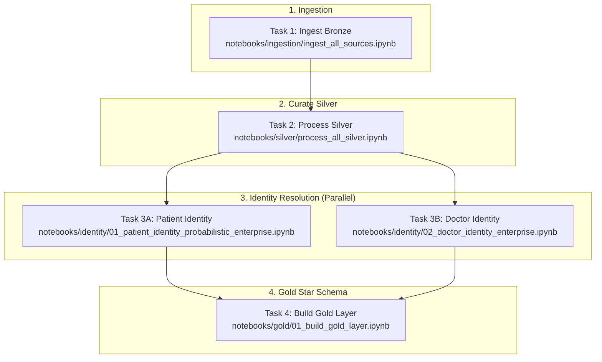

# Hospital EDW — End-to-End Pipeline Flow & Automation Guide

This document describes the complete architecture, file-by-file mapping, data flow DAG, and automation strategy for the Hospital Enterprise Data Warehouse (EDW) on Databricks.

---

## 1. High-Level Architecture Overview

The pipeline implements the **Medallion Architecture (Bronze → Silver → Gold)** with an enterprise **Probabilistic Identity Resolution** stage between Silver and Gold.

```
┌────────────────────────────────────────────────────────────────────────┐
│                        RAW FILES IN VOLUMES                            │
│   /Volumes/hospital_catalog/raw_landing/hospital_files/{branch}/...    │
└───────────────────────────────────┬────────────────────────────────────┘
                                    │
                                    ▼
┌────────────────────────────────────────────────────────────────────────┐
│                            BRONZE LAYER                                │
│  Append-only ingestion from CSV files + metadata auditing columns     │
│  Tables: hospital_catalog.bronze.* (15 source tables across 3 branches)│
└───────────────────────────────────┬────────────────────────────────────┘
                                    │
                                    ▼
┌────────────────────────────────────────────────────────────────────────┐
│                            SILVER LAYER                                │
│  Incremental high-watermark read, cleaning, standardization,           │
│  deduplication (latest wins), and Delta MERGE (upsert).               │
│  Tables: hospital_catalog.silver.* (15 curated clean tables)          │
└─────────────────────────┬──────────────────────┬───────────────────────┘
                          │                      │
                          ▼                      ▼
┌──────────────────────────────────┐   ┌─────────────────────────────────┐
│    PATIENT IDENTITY RESOLUTION   │   │    DOCTOR IDENTITY RESOLUTION   │
│  Cross-branch Fellegi-Sunter     │   │  Cross-branch Fellegi-Sunter    │
│  probabilistic matching & graph  │   │  probabilistic matching         │
│  clustering (connected components)│  │                                 │
│  Outputs:                        │   │  Outputs:                       │
│   • silver.patients_map_*        │   │   • silver.doctors_map_*        │
│   • gold.dim_patient_enterprise  │   │   • gold.dim_doctor_enterprise  │
└─────────────────────────┬────────┘   └─────────┬───────────────────────┘
                          │                      │
                          └───────────┬──────────┘
                                      │
                                      ▼
┌────────────────────────────────────────────────────────────────────────┐
│                             GOLD LAYER                                 │
│  Star Schema (Conformed Reference Dimensions + Fact Tables)            │
│  Reference Dims: dim_date, dim_department, dim_medication,             │
│                  dim_diagnosis_code, dim_payer (with SELF-PAY sentinel)│
│  Fact Tables:    fact_appointments, fact_medical_records,              │
│                  fact_admissions, fact_surgeries,                      │
│                  fact_lab_results, fact_billing                        │
│  Tables: hospital_catalog.gold.*                                       │
└───────────────────────────────────┬────────────────────────────────────┘
                                    │
                                    ▼
┌────────────────────────────────────────────────────────────────────────┐
│                        BI & ANALYTICS CONSUMPTION                      │
│  Power BI / Tableau / Databricks SQL Dashboards / Clinical Analytics   │
└────────────────────────────────────────────────────────────────────────┘
```

---

## 2. Layer-by-Layer File Mapping

### A. Raw → Bronze Ingestion Layer

| Component | Path | Responsibility |
| :--- | :--- | :--- |
| **Configuration** | [`config/ingestion_config.py`](file:///c:/Users/SALLAM/Desktop/hospital_edw/config/ingestion_config.py) | Catalog, schemas (`landing`, `bronze`), volume paths, checkpoint paths, branch list (`CAI`, `ALX`, `GIZ`), domain table definitions. |
| **Schema Contract** | [`config/schemas.py`](file:///c:/Users/SALLAM/Desktop/hospital_edw/config/schemas.py) | Explicit PySpark `StructType` schemas for all 15 source tables. |
| **File Reader** | [`src/ingestion/reader.py`](file:///c:/Users/SALLAM/Desktop/hospital_edw/src/ingestion/reader.py) | Reads CSV files with schema enforcement and error handling. |
| **Delta Writer** | [`src/ingestion/writer.py`](file:///c:/Users/SALLAM/Desktop/hospital_edw/src/ingestion/writer.py) | Appends raw data into Bronze Delta tables with schema merging. |
| **Metadata Enricher**| [`src/ingestion/metadata.py`](file:///c:/Users/SALLAM/Desktop/hospital_edw/src/ingestion/metadata.py) | Appends audit columns: `_source_branch`, `_source_system`, `_ingestion_timestamp`, `_batch_id`, `_source_file`. |
| **Pipeline Runner**| [`src/ingestion/pipeline.py`](file:///c:/Users/SALLAM/Desktop/hospital_edw/src/ingestion/pipeline.py) | Orchestrates single table ingestion end-to-end. |
| **Notebook Orchestrator** | [`notebooks/ingestion/ingest_all_sources.ipynb`](file:///c:/Users/SALLAM/Desktop/hospital_edw/notebooks/ingestion/ingest_all_sources.ipynb) | Loops through all branches and tables, executing batch ingestion. |

---

### B. Bronze → Silver Cleaning & Upsert Layer

| Component | Path | Responsibility |
| :--- | :--- | :--- |
| **Configuration** | [`config/silver_config.py`](file:///c:/Users/SALLAM/Desktop/hospital_edw/config/silver_config.py) | Table-by-table Primary Keys (`primary_key`), partition columns for deduplication (`partition_cols`), and watermark ordering column (`_ingestion_timestamp`). |
| **Domain Transformers** | [`src/silver/transforms.py`](file:///c:/Users/SALLAM/Desktop/hospital_edw/src/silver/transforms.py) | Cleaning logic for all 15 tables across EMR, Lab, Pharmacy, and Billing domains. |
| **Standardization** | [`src/silver/standardization.py`](file:///c:/Users/SALLAM/Desktop/hospital_edw/src/silver/standardization.py) | Name normalization, phone cleaning, gender/status standardization, date formatting, abnormal flag mapping (`A`, `H`, `L`, `N`). |
| **Deduplication** | [`src/silver/deduplication.py`](file:///c:/Users/SALLAM/Desktop/hospital_edw/src/silver/deduplication.py) | Window-based deduplication (`ROW_NUMBER() OVER (PARTITION BY pk ORDER BY _ingestion_timestamp DESC)`). |
| **Delta MERGE Writer** | [`src/silver/writer.py`](file:///c:/Users/SALLAM/Desktop/hospital_edw/src/silver/writer.py) | Incremental read using high-watermark (`_ingestion_timestamp > max_ts`), then executes `DeltaTable.merge()`. |
| **Notebook Orchestrator** | [`notebooks/silver/process_all_silver.ipynb`](file:///c:/Users/SALLAM/Desktop/hospital_edw/notebooks/silver/process_all_silver.ipynb) | Runs all 15 silver table incremental merges in a single batch. |

---

### C. Silver → Identity Resolution Layer (Master Data)

| Component | Path | Responsibility |
| :--- | :--- | :--- |
| **Configuration** | [`config/identity_config.py`](file:///c:/Users/SALLAM/Desktop/hospital_edw/config/identity_config.py) | Auto-merge thresholds (`AUTO_MERGE_THRESHOLD = 0.95`, Doctor: `0.92`), steward review thresholds, max component iterations, and table names. |
| **Patient Preparation** | [`src/identity/preparation.py`](file:///c:/Users/SALLAM/Desktop/hospital_edw/src/identity/preparation.py) | Loads `silver.patients`, standardizes names/national IDs, rejects corrupted/duplicate records. |
| **Patient Matching** | [`src/identity/matching.py`](file:///c:/Users/SALLAM/Desktop/hospital_edw/src/identity/matching.py) | Probabilistic blocking rules, Fellegi-Sunter scoring, edge filtering, connected components graph clustering. |
| **Patient Resolution**| [`src/identity/resolution.py`](file:///c:/Users/SALLAM/Desktop/hospital_edw/src/identity/resolution.py) | Assigns stable `EP-<uuid>` enterprise IDs, writes aliases, manages steward review queue, produces `silver.patients_map_*` and `gold.dim_patient_enterprise`. |
| **Doctor Modules** | [`src/identity/doctor_*.py`](file:///c:/Users/SALLAM/Desktop/hospital_edw/src/identity/) | Matching and resolution pipeline tailored for doctors (specialty, license, phone matching). Produces `silver.doctors_map_*` and `gold.dim_doctor_enterprise`. |
| **Notebooks** | [`notebooks/identity/01_patient_identity_probabilistic_enterprise.ipynb`](file:///c:/Users/SALLAM/Desktop/hospital_edw/notebooks/identity/01_patient_identity_probabilistic_enterprise.ipynb)<br>[`notebooks/identity/02_doctor_identity_enterprise.ipynb`](file:///c:/Users/SALLAM/Desktop/hospital_edw/notebooks/identity/02_doctor_identity_enterprise.ipynb) | Orchestrate patient and doctor enterprise identity pipelines. |

---

### D. Silver + Identity → Gold Star Schema Layer

| Component | Path | Responsibility |
| :--- | :--- | :--- |
| **Configuration** | [`config/gold_config.py`](file:///c:/Users/SALLAM/Desktop/hospital_edw/config/gold_config.py) | Table catalog paths for Gold dimensions, Gold facts, Silver source tables, and Identity bridge maps. |
| **Reference Dimensions** | [`src/gold/dimensions.py`](file:///c:/Users/SALLAM/Desktop/hospital_edw/src/gold/dimensions.py) | Builds `dim_date`, `dim_department`, `dim_medication`, `dim_diagnosis_code`, and `dim_payer` (including `SELF-PAY` sentinel `000...000`). |
| **Fact Tables** | [`src/gold/facts.py`](file:///c:/Users/SALLAM/Desktop/hospital_edw/src/gold/facts.py) | Builds `fact_appointments`, `fact_medical_records`, `fact_admissions`, `fact_surgeries`, `fact_lab_results`, `fact_billing`. Links all FKs using identity bridge maps. |
| **Delta Writer / Upsert** | [`src/gold/writer.py`](file:///c:/Users/SALLAM/Desktop/hospital_edw/src/gold/writer.py) | Overwrite for reference dimensions; resilient Delta MERGE / Spark SQL `MERGE INTO` fallback for fact tables; `OPTIMIZE` commands. |
| **Table Reset / Cleanup** | [`src/gold/cleanup.py`](file:///c:/Users/SALLAM/Desktop/hospital_edw/src/gold/cleanup.py) | Utility functions (`reset_gold_tables`, `reset_identity_tables`) to drop or truncate tables for clean restarts. |
| **Notebook Orchestrator** | [`notebooks/gold/01_build_gold_layer.ipynb`](file:///c:/Users/SALLAM/Desktop/hospital_edw/notebooks/gold/01_build_gold_layer.ipynb) | End-to-end execution of Gold dimensions, Gold facts, row count summaries, and referential integrity checks (`ri_check`). |

---

## 3. Execution Dependency Graph (DAG)

When automating in Databricks Workflows, tasks must run in the following sequence:



> [!NOTE]
> Tasks **3A (Patient Identity)** and **3B (Doctor Identity)** are completely independent and can execute **in parallel** to reduce overall pipeline runtime!

---

## 4. How Incremental Processing Works on New File Arrival

| Layer | Trigger / Mechanism | How Incremental State is Handled |
| :--- | :--- | :--- |
| **Bronze** | Databricks Auto Loader or Scheduled Batch | Reads incoming files by batch ID. Automatically ignores already ingested files using file metadata checkpoints. Adds `_ingestion_timestamp = current_timestamp()`. |
| **Silver** | Watermark Read + Delta MERGE | Queries `SELECT MAX(_ingestion_timestamp) FROM silver.<table_name>`. Reads only rows from Bronze where `_ingestion_timestamp > max_ts`. Deduplicates incoming records and executes Delta MERGE on Primary Key. |
| **Identity** | Incremental Match & Registry | Reads updated Silver patients/doctors against existing registry. Preserves existing enterprise IDs (`EP-...` / `ED-...`), resolves new cross-branch links, and upserts into bridge maps and golden dimensions. |
| **Gold** | Reference Overwrite + Fact MERGE | Conformed reference dimensions are fully re-derived in seconds. Fact tables perform Delta MERGE on natural encounter/admission/procedure/result/invoice keys, updating any changed records and inserting new ones. |

---

## 5. How to Automate in Databricks

### Method 1: Databricks Workflows (UI)

1. Navigate to **Workflows → Create Job**.
2. Name the Job: `Hospital_EDW_Daily_Pipeline`.
3. Configure the 4 tasks according to the DAG above:

| Task Name | Type | Source Path | Depends On |
| :--- | :--- | :--- | :--- |
| `01_Ingest_Bronze` | Notebook | `notebooks/ingestion/ingest_all_sources` | *None* |
| `02_Process_Silver` | Notebook | `notebooks/silver/process_all_silver` | `01_Ingest_Bronze` |
| `03A_Patient_Identity` | Notebook | `notebooks/identity/01_patient_identity_probabilistic_enterprise` | `02_Process_Silver` |
| `03B_Doctor_Identity` | Notebook | `notebooks/identity/02_doctor_identity_enterprise` | `02_Process_Silver` |
| `04_Build_Gold` | Notebook | `notebooks/gold/01_build_gold_layer` | `03A_Patient_Identity`, `03B_Doctor_Identity` |

4. **Trigger**:
   - **Scheduled (Cron)**: e.g., Every day at 02:00 UTC (`0 0 2 * * ?`).
   - **Or File Arrival Trigger**: Pointed to the raw Volume storage path.

---

### Method 2: Databricks Asset Bundles (DABs - Recommended)

Using the project's existing [`databricks.yml`](file:///c:/Users/SALLAM/Desktop/hospital_edw/databricks.yml), define the workflow programmatically in `resources/hospital_edw_job.yml`:

```yaml
resources:
  jobs:
    hospital_edw_pipeline:
      name: "[${bundle.target}] Hospital EDW End-to-End Pipeline"
      
      schedule:
        quartz_cron_expression: "0 0 2 * * ?"
        timezone_id: "UTC"
        pause_status: UNPAUSED

      tasks:
        # Step 1: Ingest Bronze
        - task_key: "ingest_bronze"
          notebook_task:
            notebook_path: "notebooks/ingestion/ingest_all_sources.ipynb"

        # Step 2: Process Silver
        - task_key: "process_silver"
          depends_on:
            - task_key: "ingest_bronze"
          notebook_task:
            notebook_path: "notebooks/silver/process_all_silver.ipynb"

        # Step 3A: Patient Identity Resolution
        - task_key: "patient_identity"
          depends_on:
            - task_key: "process_silver"
          notebook_task:
            notebook_path: "notebooks/identity/01_patient_identity_probabilistic_enterprise.ipynb"

        # Step 3B: Doctor Identity Resolution (Runs in parallel with 3A)
        - task_key: "doctor_identity"
          depends_on:
            - task_key: "process_silver"
          notebook_task:
            notebook_path: "notebooks/identity/02_doctor_identity_enterprise.ipynb"

        # Step 4: Build Gold Dimensions & Facts
        - task_key: "build_gold"
          depends_on:
            - task_key: "patient_identity"
            - task_key: "doctor_identity"
          notebook_task:
            notebook_path: "notebooks/gold/01_build_gold_layer.ipynb"
```

To deploy and run with one command:
```bash
databricks bundle deploy
databricks bundle run hospital_edw_pipeline
```
